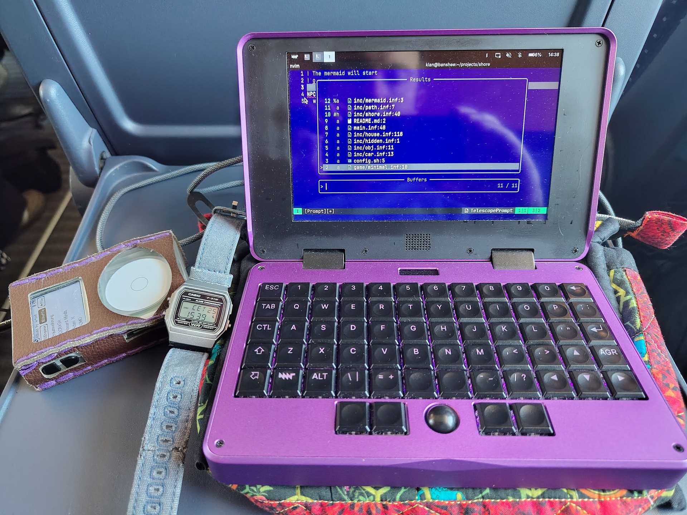
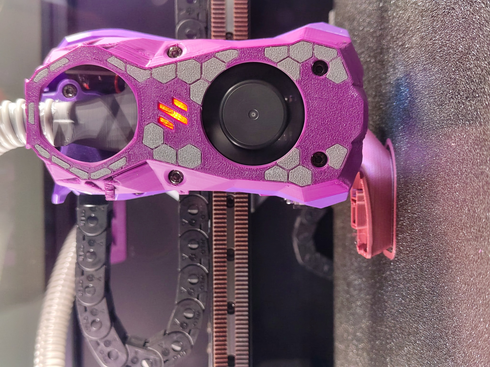
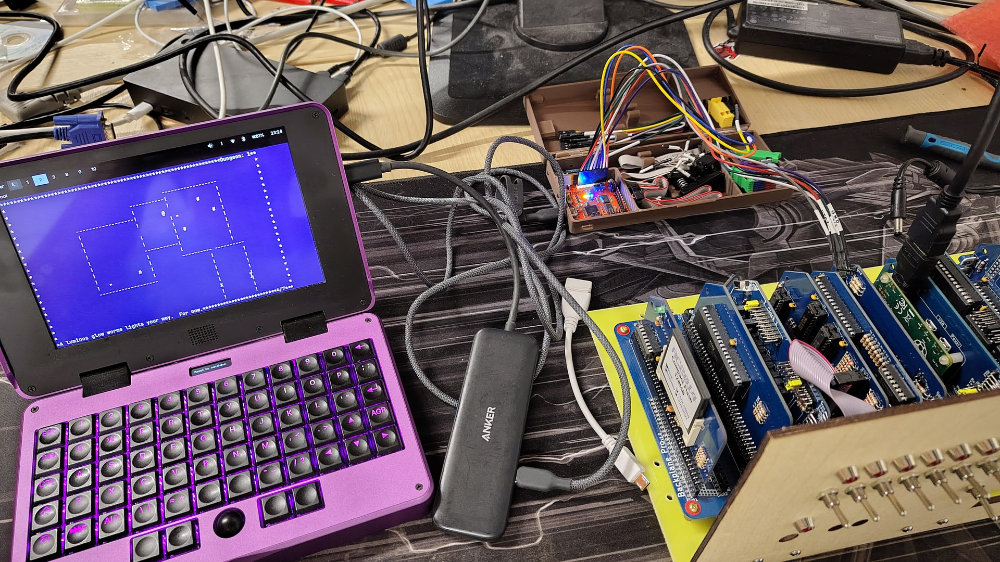
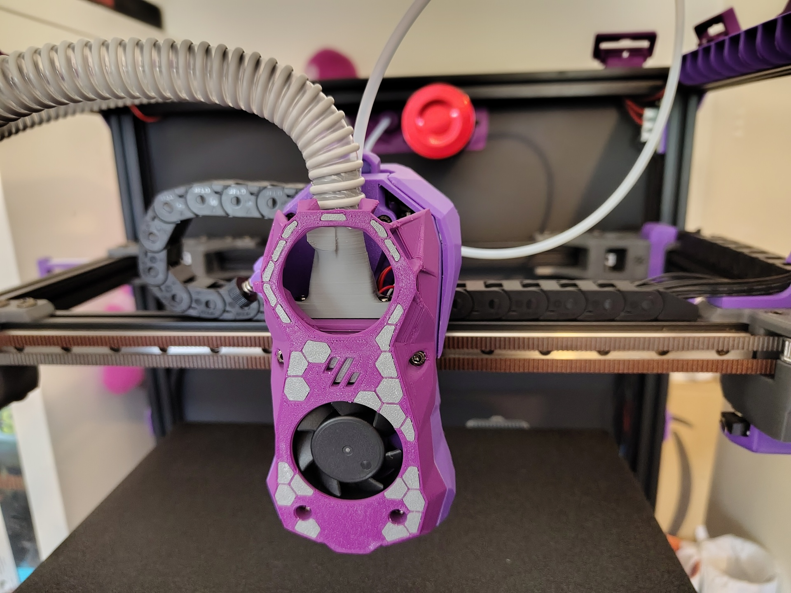

It's 2026, and [Sam Altman thinks it's a shame that you have RAM in your 
computer and not his data center](https://www.tomshardware.com/tech-industry/data-centers/openai-ceo-says-its-quite-terrible-for-your-pc-to-have-ram-sam-altman-says-data-centers-offer-better-utilization).  [The leading 3d printer manufacturer 
by sales by default sends all the models you print to AWS](https://wiki.bambulab.com/en/general/bbl-security).  [And your 
washing machine sends gigabytes of telemetry data to the manufacturer every day.](https://www.tomshardware.com/networking/your-washing-machine-could-be-sending-37-gb-of-data-a-day)

It reads like a dystopian cyberpunk novel, but in reality the modern trajectory 
of computing has shifted the ownership of resources, devices and data away from 
end users increasingly towards corporations.
[The EU is taking a moderate stand 
on consumer regulation](https://www.eff.org/deeplinks/2026/04/dos-and-donts-eus-digital-fairness-act-effs-recommendation-regulating-digital) 
(their approach to privacy has other problems), with the US increasingly taking an 
anti-regulation stance ([although right to repair is getting some traction](https://www.repair.org/)).
Organisations such as the [Open Rights Group 
(ORG)](https://www.openrightsgroup.org/) and 
the [Electronic Frontier Foundation (EEF)](https://www.eff.org/)
do an excellent job campaigning for greater transparency and accountability of the 
manufacturers of consumer devices, and would appreciate your support.

<figure>
    
    <figcaption>A MNT Pocket Reform, Tangara portable music player and Sensor Watch, 
    on a Berlin ICE train going to Open Hardware Summit 2026. These are daily drivers 
    for me while travelling.</figcaption>
</figure>

Modern hardware consists of at least three components: a physical artifact, 
software that runs on 
the artifact, and increasingly, remote services the software on the artifact calls. 
True ownership should leave the owner independent of the manufacturer 
for continued ownership: for visibility over software, for repairs, for 
replacement parts, 
for remote services. Repair guides are helpful, with 
[iFixit](https://www.ifixit.com/) providing guides 
for a range of open and closed hardware, but the gold standard is hardware 
that is open by default - where hardware and software components are documented,
allowing them to be altered, repaired and replaced as needed.

<figure>
    
    <figcaption>Voron Trident 3D Printer, printing a test Benchy model. Voron
    publish the design files for Voron printers, with different manufacturers 
    making full kits available for people to build from the instructions. 
    Support is available via forums, Discord and Reddit groups. </figcaption>
</figure>

Open Hardware is not always a walk in the park.  But it is an available choice, 
and can be a concious choice.  Open hardware invites being integrated to a range 
of environments, some planned, some unplanned.  Open sensors integrate well with 
Home Assistant, a local home automation system , and Voron printers are 
designed modularly so you can replace tool heads while keeping the remainder of the
printer.  The trade off is this flexibility may require learning new skills, 
or time setting up configuration. When 
a part fails (because mechanical parts do fail), with open hardware you have 
access to the original model files to print or model replacements.

<figure>
    
    <figcaption>A MNT Pocket Reform, being used with a Tigard for serial 
    communications with the RC2014 microcomputer.  The Tigard is a open 
    hardware diagnostic and hacking tool.</figcaption>
</figure>

[The Open Source Hardware Association (OSHA)](https://oshwa.org/) maintains a 
[list of certified projects](https://certification.oshwa.org/directory.html) 
[(it's also very straightforward to submit a project)](https://certification.oshwa.org/process/hardware.html).
Some projects are pretty well known: 
[MNT Design (Laptops)](https://mnt.re/), 
[Voron Design (Printers & CNC)](https://vorondesign.com/),
[Tangara portable music player](https://cooltech.zone/tangara/),
[AirGradient air quality monitors](https://www.airgradient.com/).

<figure>
    
    <figcaption>Voron Trident 3D Printer, modified for CPAP cooling.  The open 
    nature of the printer makes integrating radical changes, such as this cooling 
    mod and the subsequent configuration, relatively trivial.</figcaption>
</figure>

What comes next?  If we don't take ownership of hardware, we lose it. Laptop 
RAM capacity is decreasing as we're expected to offload local processing to 
cloud services, and we're increasingly beholden to a stream of monthly 
subscriptions.  Open hardware starts to help inverse control by putting ownership,
and responsibility, back in owners hands.  That responsibility may come with an 
increase in burden, and it is up to individuals and communities to help find ways 
to support that burden in a way that does not diminish individual ownership in the way 
the commercial manufacturers have done.  [Hackspaces](https://www.hackspace.org.uk/), 
[repair cafes](https://www.repaircafe.org/en/visit/), maybe [Lifehouses](https://www.versobooks.com/en-gb/products/2536-lifehouse), 
are probably part of that long term solution.

Open hardware is a journey, but one that leaves you with better skills, understanding 
community and ownership.
